  

  
  

## 00 / hello

I'm Aditya—a backend engineer who likes following an abstraction until it stops being magic.

That curiosity currently leads in two directions: down into **database internals**, and sideways into **AI-powered tools** such as Signal. I build things to understand them, keep notes that make perfect sense at midnight, and have a dangerous relationship with the phrase *“this should be a small project.”*

> Good systems answer questions. Great systems also explain what happened when the answer is wrong.

## 01 / build queue

| Project | What pulled me in | Current rabbit hole |
|:--|:--|:--|
| **tinyTSDB** | Learning time-series storage from the inside | ingestion · pages · indexes · compression · retention |
| **Signal** | Making AI useful beyond a chat window | retrieval · context · structured output · evaluation |
| **Small tools** | Scratching very specific technical itches | CLIs · automations · “temporary” scripts that become permanent |

There is no grand roadmap here. Make the idea, test the assumption, keep the interesting lessons.

## 02 / in production

At **Comviva**, I work on the Ngage platform—building and operating backend systems with **Java, Spring Boot, and Kafka**. My work spans service design, real-time data pipelines, platform reliability, and the unglamorous but essential job of making production understandable when it misbehaves.

I've also worked on observability and AIOps with **Grafana and Prometheus**, incident response with **PagerDuty and Statuspage**, and evaluating **ClickHouse** for analytical workloads. Shipping the feature is good; knowing how it behaves under pressure is better.

## 03 / things I reach for

- **Languages & core:** Java · Python · SQL · Bash
- **Backend:** Spring Boot · REST APIs · event-driven systems · distributed systems
- **Data:** Kafka · Redis · MySQL · PostgreSQL · Elasticsearch · ClickHouse
- **AI experiments:** LLM APIs · embeddings · retrieval · structured outputs · evals
- **Observability:** Grafana · Prometheus · PagerDuty · Statuspage
- **Infrastructure:** Docker · Kubernetes · Linux · Git · GitHub Actions
- **To debug reality:** logs · metrics · traces · query plans · thread dumps · an unreasonable number of debug statements

I care more about knowing *why* a tool belongs in the system than collecting logos for it.

## 04 / off the clock

- 🎧 Linkin Park has probably helped me fix more bugs than rubber-duck debugging has.
- 📷 I occasionally put the keyboard down and pick up a camera. Photography and debugging are surprisingly similar: the interesting detail is usually just outside the frame.
- 📚 My reading list grows at a much healthier rate than my finished-books list.
- 🤖 I started out exploring machine learning and data analysis; now AI has pulled me back in through the builder's entrance.
- 📺 There is usually a new show in progress—or an old one being rewatched while I pretend it is background noise.

## 05 / bits worth caching

- A B-tree can find one item among millions with only a handful of page reads. High fan-out keeps the tree surprisingly short.
- Some time-series databases compress timestamps by storing the *difference between differences* instead of every full timestamp.
- An index is a trade: faster reads in exchange for extra storage and more work on every write. There is no free `CREATE INDEX`.
- Embeddings turn meaning into geometry: related ideas end up near one another in a space with far too many dimensions to draw.
- An AI demo can be delightfully unpredictable; an AI product needs evaluations, guardrails, and predictable behavior around the model.

## 06 / opinions, weakly held

- “Boring technology” is usually a compliment.
- Observability is part of the product, even if customers never see it.
- The fastest query is the one you realise you do not need to run.
- AI should be allowed to say “I don't know”—and the surrounding software should expect it to.
- A side project is finished when it taught you what you came to learn, not when it has every feature.

<!-- rotating-meme:start -->

  
   
  Today's build mood. Shuffled daily.

<!-- rotating-meme:end -->

## 07 / notes & coordinates

I write occasionally about backend engineering, system design, and lessons that were more memorable than they needed to be.

I'm also quietly open to interesting opportunities around backend systems, data, and applied AI. If that sounds like what you're building, I'd be glad to talk.

**[Medium](https://medium.com/@adityaramachandran25)** · **[Portfolio](https://aditya-ramachandran.github.io/)** · **[LinkedIn](https://www.linkedin.com/in/aditya-ramachandran-27b2ab24a/)** · **[Email](mailto:adityaramachandran25@gmail.com)**

---

  

The snake is well-fed. The side-project list is not.

